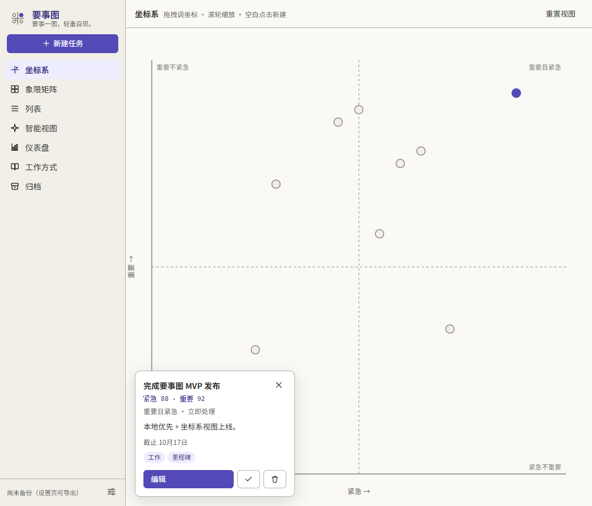
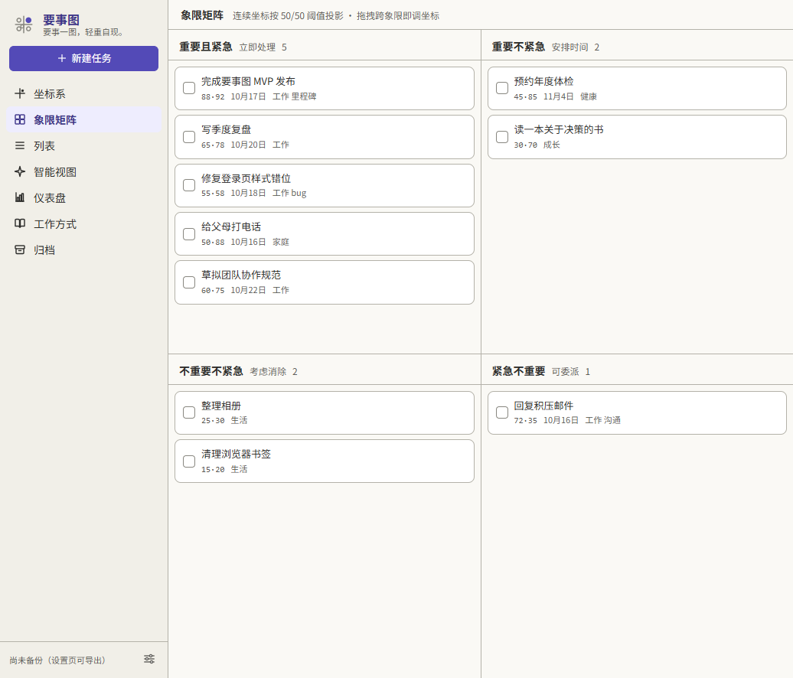
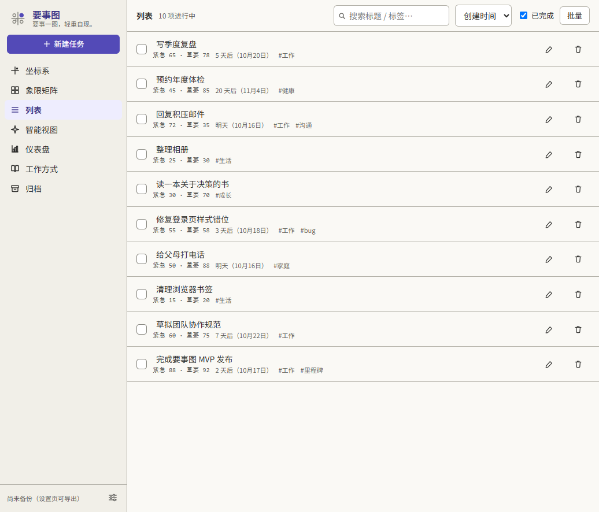
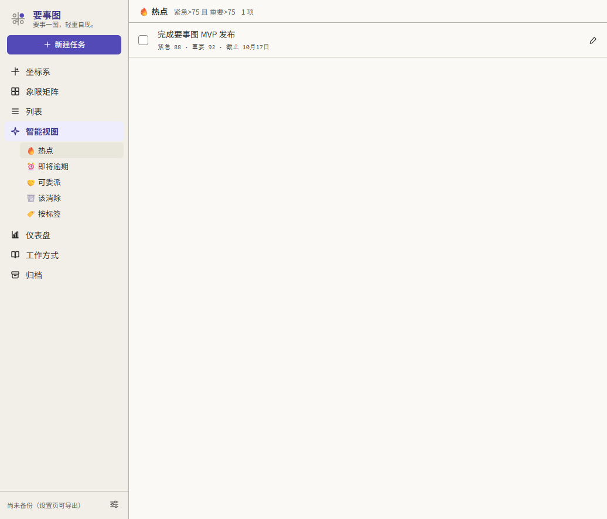
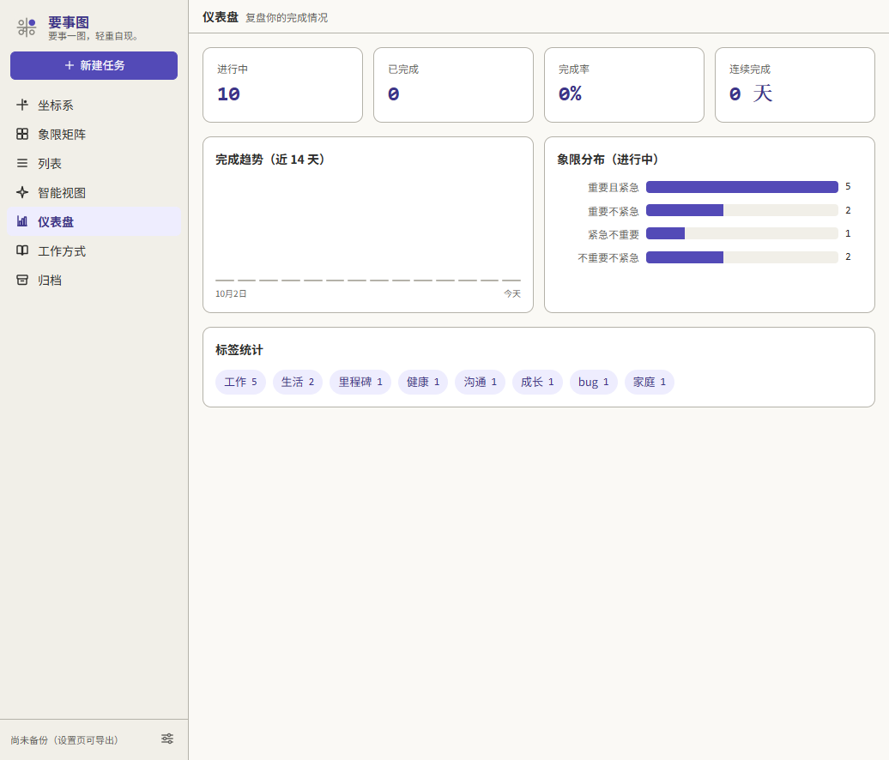
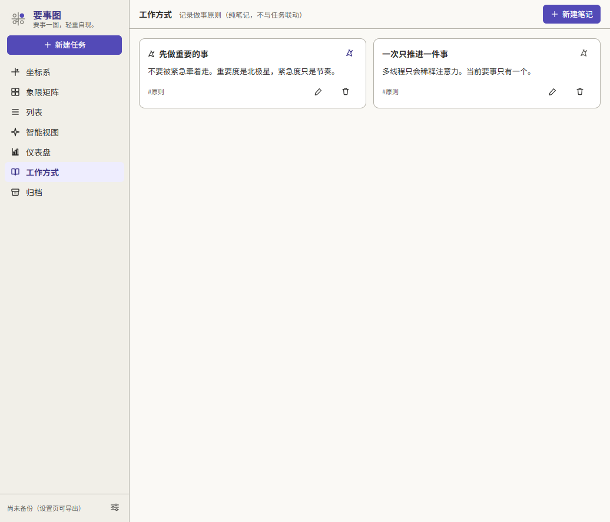
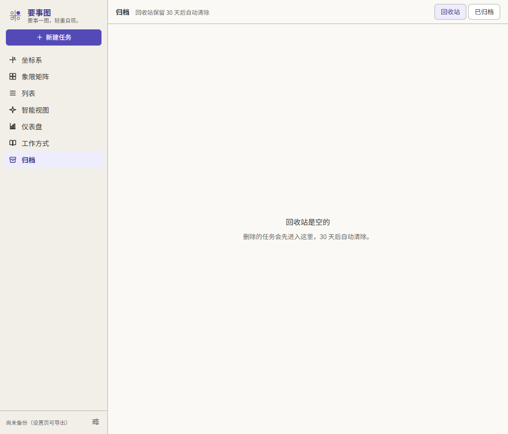
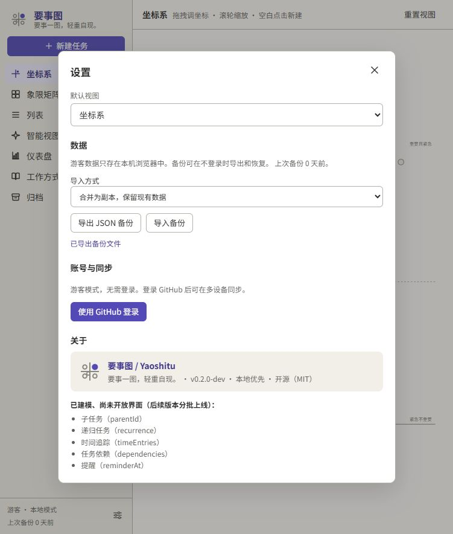

# 要事图 · Yaoshitu

> **要事一图，轻重自现。** / *What matters, mapped.*

本地优先的**坐标系任务管理器**：给每个任务一对连续坐标（紧急 1–100 × 重要 1–100），优先级不是选出来的，是在平面上摆出来的。

[](https://github.com/yhfwww/yaoshitu/actions/workflows/ci.yml)
[](#许可证)


> **当前为 v0.2 开发版。** 一期本地 MVP 可运行；新增可选 GitHub 登录与同步，本机协议和恢复验证已通过，正式域名、真实 OAuth 与两设备验收尚未完成。详见 [同步设计](docs/sync-v0.2.md) 和 [Ubuntu 部署说明](server/README.md)。

---

## 为什么不是又一个四象限待办

主流的艾森豪威尔矩阵工具（GSD Task Manager、Focus 等）只问两件事：*紧急吗？重要吗？* —— 答案是布尔值，任务只能落进四个格子，无法表达"紧急 65 分、重要 78 分"这种连续差异。

要事图把这两问换成两根**连续坐标轴**，于是：

- 优先级是**可拖拽的坐标**，不是四个抽屉里的二选一；
- 四象限矩阵依然保留，但它只是同一份坐标数据按 50/50 阈值做的**投影**（连续 → 二值化），不是另一份数据；
- 所有视图读写同一份本地数据，切换视图不丢上下文。



<sub>连续坐标 + 四象限分区线常显 + 拖拽调优先级；右上角实心紫点即当前选中的「要事」。</sub>

---

## 视图一览

### 1. 坐标系（旗舰视图）

连续坐标平面。拖拽任务点即改优先级（完全自由、无磁吸）；滚轮以光标为锚点缩放；点击空白处按该坐标直接建任务；重叠任务点自动散开，hover 出信息卡；完成态任务移出平面（只在列表可见）。

### 2. 象限矩阵

把连续坐标按 50/50 投影成四象限，跨象限拖拽即等价于调坐标。照顾习惯经典矩阵的用户。



### 3. 列表

等价列表视图，无障碍主通道：搜索、排序、批量操作，键盘与读屏可达。



### 4. 智能视图

基于连续坐标**梯度**的自动筛选（而非布尔/依赖判定），一期固定 5 个：🔥 热点（紧急>75 且 重要>75）、⏰ 即将逾期、🤝 可委派、🗑️ 该消除、🏷️ 按标签聚合。



### 5. 仪表盘 / 复盘

完成趋势（近 14 天）、象限分布、标签统计、连续完成 streak。



### 6. 工作方式（Principles）

纯笔记模块，用来记录做事原则。**不与任务联动** —— 它只是你自己的原则清单。



### 7. 归档

软删除进回收站，保留 30 天后自动清除，也可永久归档。删除是**结构安全**的，不依赖会自动消失的 toast 撤销。



---

## 其他能力

- **命令面板** —— `Ctrl/Cmd + K` 跳视图 / 新建 / 搜索
- **快捷键** —— `n` 新建、`/` 搜索、`Esc` 取消选中
- **本地优先** —— 页面操作先写浏览器 IndexedDB，游客模式零业务外部请求、无遥测；GitHub 登录后可选云同步
- **账号隔离与同步** —— 游客、不同账号分别存储；持久队列、字段合并、服务器版本检查与冲突旧值恢复
- **JSON 导入导出** —— 版本化备份信封（`app: "yaoshitu"`, `formatVersion: 1`），设置页显示"上次备份 N 天前"
- **默认视图可配** —— 默认坐标系，可在设置里更改
- **无障碍** —— 语义化标签、`role`、`aria-*`、可见焦点环；坐标系不依赖色相表意（象限用位置 + 颜色双重编码），列表视图为无障碍兜底通道
- **可安装 · 可离线** —— Web App Manifest + Workbox 预缓存（service worker）。SW 接管后断网也能打开应用；图标含 192 / 512 / 512-maskable 与 `apple-touch-icon`，不再是桌面上的白块

---

## 快速开始

需要 **Node.js ≥ 20.19**（或 ≥ 22.12，Vite 8 的要求）。

```bash
cd src
npm install
npm run dev        # http://localhost:5173
```

其他命令：

```bash
npm run build      # 类型检查 + 生产构建，产物在 src/dist
npm run typecheck  # 仅类型检查
npm test           # 单元测试（vitest，跑一次）
npm run test:watch # 单元测试（watch 模式）
npm run preview    # 预览生产构建
npm run icons      # 从 public/app-icon.svg 重新生成整套 PWA 图标
```

游客首次启动会自动注入一份示例数据（10 个任务 + 2 条原则笔记）；设置页可导出完整 JSON，导入默认合并为副本。游客可选择覆盖恢复，账号空间只允许合并。云同步需要配置服务地址，详见 [Ubuntu 部署说明](server/README.md)。



---

## 技术栈

| 层 | 选型 | 版本 |
|---|---|---|
| 语言 / 框架 | React + TypeScript | 19.2 / 5.9 |
| 构建 | Vite（Rolldown 引擎） | 8.2 |
| 状态 | Zustand | 5 |
| 存储 | Dexie（IndexedDB，schema versioning） | 4 |
| 坐标系渲染 | 原生 SVG（500 点规模足够，Canvas 留作上万点优化项） | — |
| PWA | vite-plugin-pwa + Workbox 预缓存 | 2.0 / 7.4 |
| 测试 | vitest（jsdom 提供 DOM，fake-indexeddb 提供 IndexedDB） | 5 |
| 工程 | CI 门禁（GitHub Actions：`npm ci` → `typecheck` → `test` → `build`） | — |
| 可选后端 | 自托管 PocketBase + SQLite（游客无需后端） | 0.40.5 |

## 目录结构

```
yaoshitu/
├── docs/                        需求规格 · 品牌系统 · 工作日志
├── server/                      PocketBase 迁移/同步接口/加密/Ubuntu 部署
├── src/                         一期 MVP 应用本体
│   ├── src/
│   │   ├── db/                  schema（全量建模）/ Dexie 访问层 / 示例数据
│   │   ├── store/               Zustand 全局状态（任务 · 笔记 · 设置 · UI）
│   │   ├── lib/                 坐标几何与碰撞 · 日期 · 备份 · 视图注册表
│   │   ├── components/          侧边栏 · 命令面板 · 任务编辑器 · 设置
│   │   ├── views/               7 个视图
│   │   └── test/                测试前置（给 Dexie 装上假 IndexedDB）
│   └── public/                  图标源图（方案 A）· 生成的 PNG 图标集 · favicon 方案 B
├── LICENSE                      MIT
└── .gitignore                   排除 REF/（第三方参考实现）与未剪裁素材
```

---

## 数据与隐私

- **本机读写入口**是 IndexedDB（游客库名 `yaoshitu`，账号按服务器与用户隔离），通过 Dexie versioning 升级。跨设备合并以服务器版本为准。
- 游客不启用同步；登录仅支持 GitHub，不维护用户密码，无分析埋点。首次登录不会自动上传游客数据。
- 云端业务正文和冲突旧值静态加密，服务器持钥；浏览器数据与导出的 JSON 默认不加密。服务器备份和用户 JSON 是独立恢复路径，不能用同步代替备份。
- service worker 只预缓存应用自身的静态资源（同源），**不向任何域外地址发请求** —— 离线能力不引入第三方运行时依赖，Workbox 已随构建产物打进本地文件。
- 数据模型一次性全量建模（子任务、递归、时间追踪、依赖、提醒等字段都在 schema 里），UI 分批上线 —— 具体"已建模未出 UI"的清单直接写在应用的设置页里，不夸大实装范围。
- 导入导出是你自己的事：导出即得到一个人类可读的 JSON 文件，随时可带走。

---

## 项目状态与路线图

**一期 MVP（已完成，纯本地）**：7 个视图 · 任务 CRUD · 标签 · 命令面板与快捷键 · JSON 导入导出 · 品牌落地。

**已建模、尚未开放界面**（字段已在 schema，UI 留待后续版本）：

- 子任务 `parentId`
- 递归任务 `recurrence`（一个点代表整个系列）
- 时间追踪 `timeEntries`
- 依赖 `dependencies`
- 提醒 `reminderAt`

**v0.2（实施中）**：本地游客 + GitHub / 邮箱密码登录（含验证和找回密码，首页提供入口）、账号空间隔离、PocketBase 字段同步、删除防复活、完整备份、静态加密与 Ubuntu 部署配置。本机协议验证及快照恢复演练已通过；真实 GitHub 回调、两设备离线验收、Ubuntu 容器运行与异地备份配置待部署。独立同步历史视图、插件仍未开始。

**自动化测试**：`npm test` 覆盖坐标、日期、视图、完整备份校验、store CRUD、回收站、本地事务与账号隔离、模拟断网重试。服务端纯协议测试：`node --test server/tests/merge.test.cjs`。真实临时 PocketBase 集成与恢复演练见 [部署说明](server/README.md)。

**测试不覆盖**：React 组件渲染、拖拽 / 键盘 / 触摸交互、PWA 离线行为。这些改动仍必须手工验证，别把 CI 绿当成功能正确。

**已知缺口（诚实清单）**：

- 无深色模式
- 移动端触摸手势未适配（缺长按菜单 / 底部 sheet 来替代 hover 与拖拽）
- 无障碍目前是"写的时候注意"，未做系统性验证（键盘完成全流程、读屏实测）
- 坐标系 500 点的 60fps 目标**尚未压测验证**

---

## 文档

| 文档 | 内容 |
|---|---|
| [`docs/task-matrix-requirements.md`](docs/task-matrix-requirements.md) | 需求规格 v1.5：视图架构、功能清单、非功能需求、风险与假设、8 轮变更记录 |
| [`docs/brand-system.md`](docs/brand-system.md) | 品牌系统 v1.1：名称解读、Slogan 体系、LOGO 方案、品牌色与字体、使用规范 |
| [`docs/memory/2026-08-16.md`](docs/memory/2026-08-16.md) | 工作日志：需求澄清与实现过程中的关键决策与踩坑记录 |

## 品牌

- 名称：**要事图 / Yaoshitu** —— 要事（重要度轴、北极星）+ 图（坐标系视图）；`yàoshì` 谐音「钥匙」，是个彩蛋
- 主色：**purple 600 `#534AB7`**，全站唯一高饱和色，其余走灰阶
- 坐标系中的语义复用：**选中任务 = 实心紫点，其余 = 空心灰点**
- 禁用红绿表意（紧迫/重要不靠色相区分）

详见 [`docs/brand-system.md`](docs/brand-system.md)。

## 许可证

[MIT](LICENSE) © 2026 yhf

核心开源；未来的云同步模块计划以独立闭源模块提供（Open Core 模式）。

## 反馈

项目处于草稿阶段，欢迎开 Issue 讨论想法与问题。
